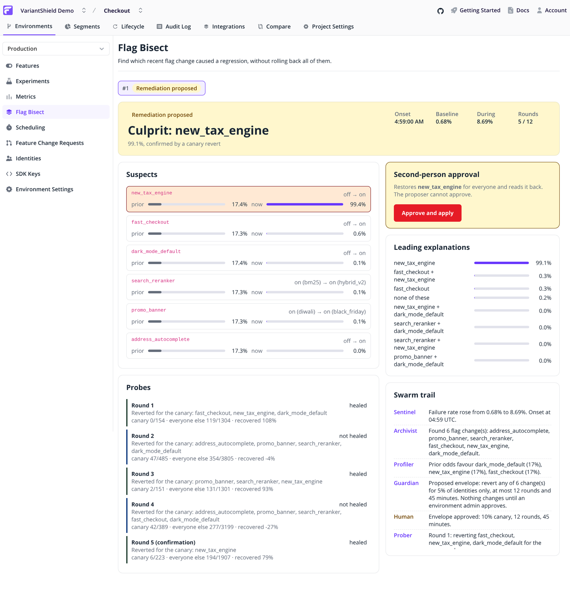

# Flag Bisect for self-hosted Flagsmith

**Six flags changed and checkout broke. Which one did it?**

Flag Bisect is built into a self-hosted Flagsmith. When the failure rate rises after several flag changes, it finds the
change that caused it without rolling all of them back. It reverts a few changes for a small canary of identities,
compares the canary with everyone else, and repeats until one change (or a pair that only breaks together) explains the
regression. A person approves before anything changes. A second person approves before the culprit is switched back for
everyone.

It reads its failure signal from the events your app already sends to **Flagsmith Experimentation**, so there is nothing
new to integrate.



> Toggle Wars entry, **Track 03: Build on Open Source Flagsmith**. An independent contribution to the open-source
> Flagsmith codebase, built during the hackathon. It is not an official Flagsmith product.

## Why

Teams change several flags at once all the time: a release train, a Friday clean-up, an experiment roll-out. When errors
climb an hour later, the usual choices are poor. Rolling everything back throws away five good changes to undo one bad
one. Guessing one at a time costs a full deploy-and-wait cycle per guess, while customers keep failing.

Flag Bisect uses what Flagsmith already has (segments, percentage splits, segment overrides and flag history) to test
the suspects on a few identities at once, and only for as long as it takes.

## How it works

| Step | Who                   | What happens                                                                                                                                                                                                                         |
| ---- | --------------------- | ------------------------------------------------------------------------------------------------------------------------------------------------------------------------------------------------------------------------------------ |
| 1    | Sentinel              | Watches the failure rate per minute and dates the onset (CUSUM).                                                                                                                                                                     |
| 2    | Archivist             | Lists every change to an environment default in the 2 hours before the onset, from Flagsmith's own history (feature versions, or history rows without versioning). Skips flags that a running experiment controls.                   |
| 3    | Profiler              | Gives each change prior odds from its timing.                                                                                                                                                                                        |
| 4    | Guardian              | Proposes an envelope: canary size, maximum rounds and minutes. **Nothing changes until an environment admin approves it.**                                                                                                           |
| 5    | Prober                | Reverts a subset of changes for a system segment with a `PERCENTAGE_SPLIT` rule, through segment overrides. Everyone else keeps today's flags.                                                                                       |
| 6    | Judge                 | After 30 seconds, compares the canary with everyone else using an always-valid sequential test (mSPRT), and updates the odds of every explanation: one change, a pair, or "not a flag". The next subset is chosen to learn the most. |
| 7    | Judge                 | Before anyone acts, one more probe reverts only the suspected culprit.                                                                                                                                                               |
| 8    | Scribe and two people | One person proposes restoring the culprit for everyone; **a different person or API key must approve**. Flag Bisect writes the flag, reads it back and removes the canary segment.                                                   |

Every step is in the incident's trail and Flagsmith's audit log.

## How it uses Flagsmith

- **A native page** in each environment's navigation, next to Experiments, built with Flagsmith's own React components,
  RTK Query services and design tokens. It works in light and dark mode and on a phone.
- **Experimentation events as the signal.** Apps send `checkout_completed` and `checkout_failed` with an SDK to
  `POST /api/v1/events`, stored in Flagsmith's own Postgres database. Flag Bisect reads them per identity. Servers can
  also report outcomes directly to `POST /api/v1/flag-bisect/signals/`.
- **Segments and percentage splits** for the canary. Membership uses the same hash the SDKs use, so the canary that is
  measured is exactly the canary that is served.
- **Segment overrides** written through the same services the flag API uses, with and without feature versioning.
- **Flag history** (feature versions, or history rows) to find what changed and what to revert to.
- **The task processor** runs the swarm every 30 seconds.
- **Permissions, change requests and the audit log.** Only environment admins see it. It refuses to act where change
  requests are required. Every human decision is audited.
- **Experiments are respected.** Flags under a running or paused experiment are never overridden.
- **Prometheus metrics and structured events** follow Flagsmith's conventions.

## Try it

### One command

You need Docker. From the repository root:

```bash
docker compose -f docker-compose.yml -f flag-bisect-demo/docker-compose.yml up --build
```

This is Flagsmith's own `docker-compose.yml` (Postgres, API, task processor, Experimentation events in Postgres) with
the image built from this repository and `FLAG_BISECT_ENABLED=true`. Open <http://localhost:8000>, create your account,
an organisation and a project.

If Docker Hub or Amazon's public registry refuses the base images (for example `429 Too Many Requests`), point the build
at another copy of the same images:

```bash
NODE_IMAGE=docker.io/library/node docker compose -f docker-compose.yml -f flag-bisect-demo/docker-compose.yml up --build
```

`NODE_IMAGE` and `WOLFI_BASE_IMAGE` are build arguments of the repository's `Dockerfile`; their defaults are unchanged.

### Break checkout on purpose

1. In **Account → Keys**, create an API token, and copy the environment's client-side key from **SDK Keys**.
2. Start the demo. It points the environment's events at Flagsmith's database, tells Flag Bisect which events mean
   failure and success, creates six flags and starts simulated shoppers:

   ```bash
   python3 flag-bisect-demo/demo.py --token <API token> --environment <environment key>
   ```

3. After a 10-minute healthy baseline it changes all six flags. `new_tax_engine` is the one that breaks checkout.
4. Open **Flag Bisect** in the environment's menu. Within about two minutes an incident is waiting for you: approve the
   envelope, watch the probes, then propose the fix. Approving it needs a second admin, or run the demo with
   `--second-token` holding a different admin's master API key.

Only the Python standard library is needed. Add `--approve-envelope` to let the demo approve the envelope for you.

### Without Docker

Follow [the API](../api/README.md) and [frontend](../frontend/README.md) guides, then set `FLAG_BISECT_ENABLED=true` and
`EXPERIMENTATION_ENABLED=true` for the API and the task processor.

## What has been verified

**Live, against this Flagsmith running locally** (PostgreSQL 16, the API, the task processor and the React dashboard):

- Six flags were changed through Flagsmith's API, and every simulated shopper asked the SDK endpoint which flags it
  gets. The failure rate went from 0.68% to 8.69%.
- The swarm opened incident #1 with all six changes as suspects and waited for approval.
- Over five rounds it named **`new_tax_engine` at 99.1%**, confirmed by a revert of that flag alone (canary 6/223
  failed, everyone else 194/1,907).
- The fix was proposed with the dashboard's own button. The same person's approval was refused (403); a second admin key
  approved it.
- Flag Bisect switched `new_tax_engine` off, read it back, and confirmed recovery. The other five changes stayed live.
  No canary segments were left behind. 67,776 requests in total.
- A second run took its failure signal only from **Experimentation events**: simulated shoppers sent
  `checkout_completed` and `checkout_failed` to `POST /api/v1/events`. It found `new_tax_engine` at 99.1% in five rounds
  and resolved the same way.

Screenshots of each state are in [`screenshots/`](screenshots). Every bug found while testing other variants and
configurations, with its fix and regression test, is in [VERIFICATION.md](VERIFICATION.md), along with 2,592 simulated
incidents that stress the statistics.

**Tests:** 99 backend tests cover the app at 100% of lines, on Flagsmith with and without feature versioning: the
statistics engine, every state, both human gates, the Experimentation event source and the API. Strict mypy, ruff and
the migration check pass. The frontend passes ESLint and its unit tests.

## Limits

- It needs traffic: the smaller the regression, the more requests each probe needs.
- It handles one culprit or a pair that only fails together. Three or more interacting changes end as inconclusive.
- Identity overrides take precedence over the canary.
- The task processor disables any recurring task after four failures in a row (for example while the database refuses
  connections). No new incidents open until it is enabled again.
- An unsolicited feature of this size would need design discussion with Flagsmith's maintainers before it could be
  proposed upstream.

## Where the code is

| Path                                               | What                                                     |
| -------------------------------------------------- | -------------------------------------------------------- |
| `api/features/flag_bisect/`                        | Django app: engine, models, services, API, task, metrics |
| `api/tests/unit/features/flag_bisect/`             | Tests                                                    |
| `frontend/web/components/flag-bisect/`             | Dashboard components                                     |
| `frontend/web/components/pages/FlagBisectPage.tsx` | The page                                                 |
| `docs/docs/managing-flags/flag-bisect.md`          | Documentation                                            |
| `flag-bisect-demo/`                                | This guide, the demo and the Docker setup                |
