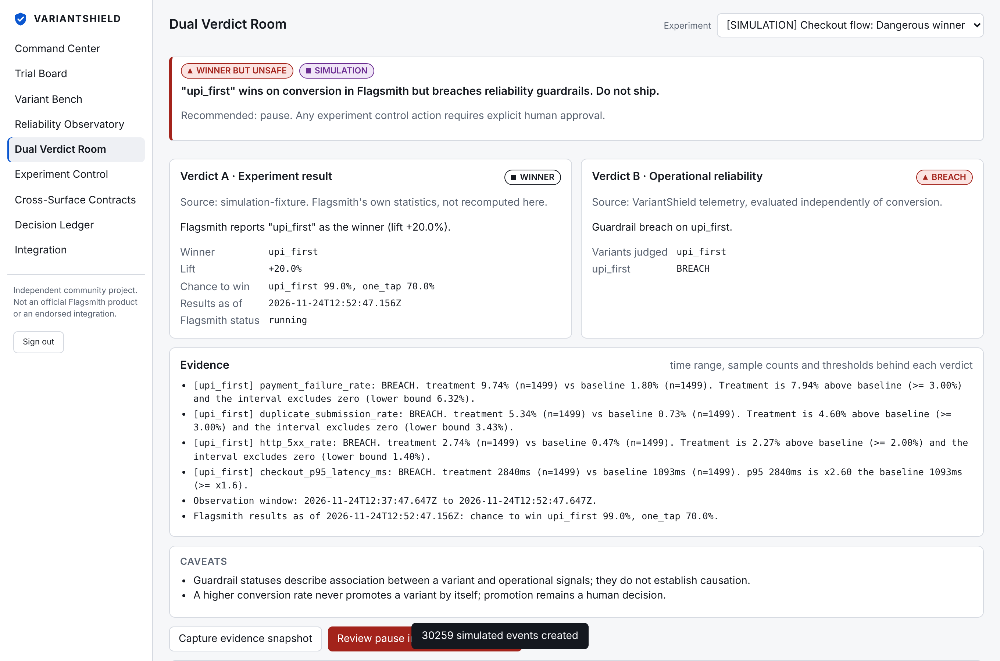

# VariantShield

**Don't just find the winning variant. Prove that it is safe to ship.**

VariantShield adds variant-level **reliability guardrails** to self-hosted [Flagsmith](https://flagsmith.com) experiments. Flagsmith tells you which variant converts better; VariantShield tells you whether that variant is operationally safe (payment failures, duplicate submissions, 5xx rate, p95 latency), shows both verdicts side by side with the evidence, and lets a human pause the experiment through Flagsmith's own API.

> **Independent community project.** Not an official Flagsmith product and not endorsed by Flagsmith. It uses only Flagsmith's public REST and SDK endpoints and copies none of its code. Licensed BSD-3-Clause.



## What you get

| Screen | What it does |
|---|---|
| **Command Center** | Flagsmith connection health, experiments by state, alerts, telemetry volume (real and simulated kept apart), recent control actions. |
| **Experiment Trial Board** | Plans (hypothesis, variants, metric, acceptance criteria, owner, approval) in eight columns **derived from backend state**: Flagsmith status, bench results, guardrails. |
| **Variant Bench** | A nine-test Playwright acceptance suite run against `control`, `upi_first` and `one_tap`, with controlled fault injection and screenshot comparison. |
| **Reliability Observatory** | Per-variant metric tables with sample sizes, thresholds, confidence bounds and bar comparisons. |
| **Dual Verdict Room** | Verdict A (Flagsmith's result, read-only) next to Verdict B (reliability), one of five outcomes, evidence, caveats, stored snapshots. |
| **Experiment Control** | Pause / resume / complete with dry run, typed confirmation, reason, audit trail and before/after verification against Flagsmith. |

More screenshots: [`docs/screenshots/`](docs/screenshots/) (`live-*.png` were taken against a real Flagsmith; the others against the test fixtures).

## Quick start (no Flagsmith needed)

```bash
cd variantshield
npm ci
npm run simulate        # both scenarios, deterministic, labelled SIMULATION
```

```
== Dangerous winner: upi_first wins on conversion but payment failures, duplicate submissions and p95 latency regress.
   Outcome: WINNER_BUT_UNSAFE. "upi_first" wins on conversion in Flagsmith but breaches reliability guardrails. Do not ship.
   Recommended action: pause (requires human approval)
     - [upi_first] payment_failure_rate: BREACH. treatment 9.74% (n=1499) vs baseline 1.80% (n=1499) ...
```

Then `npm run serve`, open <http://127.0.0.1:8787>, sign in with the admin token printed at start (or `VARIANTSHIELD_ADMIN_TOKEN`), and use **Run dangerous winner** on the Command Center.

## Run it with a real Flagsmith

See [`docs/guides/FLAGSMITH_SETUP.md`](docs/guides/FLAGSMITH_SETUP.md), [`SELF_HOSTING.md`](docs/guides/SELF_HOSTING.md) and the 14-step [`DEMO_SCRIPT.md`](docs/DEMO_SCRIPT.md) (contracts: [`CONTRACTS_DEMO.md`](docs/guides/CONTRACTS_DEMO.md)). In short:

```bash
export FLAGSMITH_URL=http://localhost:8000 FLAGSMITH_ENVIRONMENT_KEY=... FLAGSMITH_ADMIN_API_KEY=...
node scripts/verify-flagsmith.ts            # confirm the adapter works against your instance
npm run serve                               # VariantShield on :8787
DEMO_EXPERIMENT_ID=<id> VARIANTSHIELD_URL=http://127.0.0.1:8787 VARIANTSHIELD_INGEST_KEY=... npm run demo:checkout
node scripts/live-demo.ts --approve "PAUSE <id>"   # omit --approve to stop at the dry run
```

## How it decides

* **Guardrail statuses:** `INSUFFICIENT_DATA`, `HEALTHY`, `WARNING`, `BREACH`, `RECOVERING`. A variant is only `HEALTHY` when every metric has enough samples; a breach needs the confidence interval of the difference to exclude zero; a clean window after a breach is `RECOVERING` until enough clean windows pass.
* **Dual verdict outcomes:** `WINNER_AND_SAFE`, `WINNER_BUT_UNSAFE`, `HEALTHY_BUT_INCONCLUSIVE`, `INSUFFICIENT_EVIDENCE`, `REQUIRES_INVESTIGATION`. A higher conversion rate never promotes a variant by itself.
* **Verdict A is Flagsmith's.** VariantShield reads `chance_to_win` and credible intervals from Flagsmith and applies a visible win rule (Flagsmith's sample floors, chance to win >= 0.95, interval above zero). It never recomputes statistics.
* **Telemetry never guesses the variant.** Events carry the variant Flagsmith assigned; events without one are stored as `missing`/`unknown_variant` and flagged, never attributed. Attribute names follow the [OpenTelemetry feature-flag conventions](https://opentelemetry.io/docs/specs/semconv/registry/attributes/feature-flag/).

Details and diagrams: [`docs/architecture/OVERVIEW.md`](docs/architecture/OVERVIEW.md). Integrating your own app: [`docs/guides/INTEGRATION.md`](docs/guides/INTEGRATION.md).

## Cross-surface experiment contracts

Declare how one experiment must behave across web, mobile, payment and risk services in a versioned YAML/JSON contract, propagate a pseudonymous signed identity, and let VariantShield flag assignment mismatches, environment mismatches, unlinked identities, version skew, invalid feature combinations and missing or stale surfaces. It reuses Flagsmith's own assignment; it never buckets users. Guide: [`docs/guides/CONTRACTS.md`](docs/guides/CONTRACTS.md). API: [`docs/API.md`](docs/API.md). Example: [`examples/checkout-journey.contract.yaml`](examples/checkout-journey.contract.yaml). Dashboard: `#/contracts`. VariantShield is an independent open-source project, not an official Flagsmith product.

## Decision memory, assistant and MCP

The **Decision Ledger** (`#/ledger`) remembers what was known and who decided what, per experiment plan or contract. It is append-only, hash-chained and signed. A decision is **official** only after a different person approves it, and approving after the facts changed needs an explicit acknowledgement. A **rule-based assistant** (no model, nothing leaves your server) answers from those records with citations and drafts decisions for a person to record. An **MCP server** gives coding assistants the same read access, read-only by default. Guides: [`docs/guides/LEDGER.md`](docs/guides/LEDGER.md), [`docs/guides/MCP.md`](docs/guides/MCP.md). A draft upstream discussion (not posted) is in [`docs/upstream/`](docs/upstream/).

## Commands

| Command | Purpose |
|---|---|
| `npm run check` | typecheck + lint + every test |
| `npm test` | 299 tests (unit, API integration, CLI, surfaces, end to end, Playwright UI) |
| `npm run vs -- contract validate --file examples/checkout-journey.contract.yaml` | validate a contract manifest (also `register`, `check`, `report`) |
| `npm run mcp` | MCP server on stdio (set `VARIANTSHIELD_MCP_TOKEN`) |
| `npm run vs -- ledger verify` | verify the decision ledger (`--file export.json --expect-head <hash>` for an offline check) |
| `npm run surfaces` | four sample surfaces (web, mobile simulator, payment API, risk engine) on :8801-8804 |
| `npm run demo:contracts` | live contract demo: healthy, bad combination, stale variant |
| `npm run serve` | API + dashboard |
| `npm run demo:checkout` | checkout demo (variants from Flagsmith) |
| `npm run simulate` | both scenarios, in memory |
| `npm run bench -- --fault payment_failures` | run the Playwright suite from the CLI |
| `node scripts/traffic.ts --users 1000` | synthetic users against the demo (real Flagsmith assignments) |

## Configuration

Copy [`.env.example`](.env.example). Required in production (24+ random characters each; weak values are refused): `VARIANTSHIELD_ADMIN_TOKEN`, `VARIANTSHIELD_INGEST_KEY`, `VARIANTSHIELD_IDENTITY_SECRET`, `VARIANTSHIELD_IDENTITY_ISSUER_KEY`. Optional: `VARIANTSHIELD_VIEWER_TOKEN`, `VARIANTSHIELD_LEDGER_KEY`, `VARIANTSHIELD_ALLOW_SELF_APPROVAL`, `VARIANTSHIELD_IDENTITY_TOKEN_SECRET`, `VARIANTSHIELD_TRUST_PROXY`, `VARIANTSHIELD_MAX_OBSERVATIONS_PER_CONTRACT`, `VARIANTSHIELD_HISTORY_RETENTION_DAYS`. Surfaces use per-surface keys (`variantshield contract surface-keys`). For Flagsmith: `FLAGSMITH_URL`, `FLAGSMITH_ENVIRONMENT_KEY`, and `FLAGSMITH_ADMIN_API_KEY` or `FLAGSMITH_ADMIN_TOKEN` (server-side only). Others: `PORT`, `HOST`, `VARIANTSHIELD_DB_PATH`, `CORS_ORIGINS`, `RETENTION_DAYS`, `VARIANTSHIELD_DEMO_MODE`, `GUARDRAIL_CONFIG_JSON`.

## Verification status (what was actually run)

The full, dated record of what was executed against a real Flagsmith (commands, numbers, defects found) is in [`docs/RUN_LOG.md`](docs/RUN_LOG.md).

| Check | Result |
|---|---|
| `tsc --noEmit` (strict), `eslint` | pass |
| 299 automated tests (`npm run check`, exit 0) | pass: Phase 1 suites plus contracts 49, adapter 27, contract API 31, security API 27, ledger API 34, MCP 11, cross-browser smoke 2, ledger UI journey 1, CLI 14, surfaces 8, contract UI journey 1 (includes the Integration page) |
| Contract demo (`scripts/contract-demo.ts`) | passes all three phases against a **real Flagsmith** in production mode with per-surface keys (16 customers re-verified against Flagsmith) |
| Assignment-config drift on real Flagsmith | **run live**: changing the running experiment's weights moved the fingerprint `2b5fc810...` to `acfe9129...`, one drift record; restoring returned it |
| Environment mismatch live | **run live** with a second real Flagsmith environment: `ENVIRONMENT_MISMATCH` raised from the differing fingerprints |
| Reliability demo and human-approved pause | **run live** against a real Flagsmith: `WINNER_BUT_UNSAFE`, pause confirmed by an independent re-read |
| MCP | a real Claude Code session connected and called a tool through the server |
| Playwright bench: clean run | 27/27 pass; each of 4 injected faults fails only the targeted variant |
| Real Flagsmith (built from source, PostgreSQL 16) | adapter, events, results parsing, lifecycle and the 14-step demo verified |
| Docker image | CI job `docker` passes: image builds, starts read-only with all capabilities dropped, passes its health check, and refuses a weak production secret. `compose.yaml` and `compose.with-flagsmith.yaml` pass `docker compose config`; the stack itself was never brought up |
| CodeQL | CI `analyze` passes on the head commit. Its demo-cookie findings (no `Secure`, missing `httpOnly`) are resolved: each cookie branch now spells out its flags literally, and all three review threads closed after the re-scan |
| Cross-browser (Chromium, Firefox, WebKit) | the dashboard renders and fits a 390 px screen, and the demo's identity cookie persists, in all three. Getting there found two WebKit-only problems that CI caught: it **drops a `Secure` cookie over `http://127.0.0.1`** (the demo issued a new identity per request; now `Secure` is omitted only for loopback clients over plain HTTP, remote and HTTPS clients always get it) and it **leaks the text inside a narrow `<select>` into page overflow** (29 px at 390 px; selects now clip their text) |
| Flagsmith Cloud, ClickHouse/Databricks warehouses | not tested |
| Measured on 20k observations | `/report` 1.9 s to 0.23 s cold after removing two quadratic loops; the repeat read is served from a 5 s cache |

## Known limitations

* Guardrails show association, not causation; traffic mix, deploys and other confounders are not controlled.
* Statuses use a single window with a short recovery history; there is no seasonality model.
* Flagsmith documents experiments as remote-evaluation only, so local-evaluation SDKs are not covered.
* The Flagsmith "winner" is derived from `chance_to_win`; if Flagsmith changes its results payload the adapter fails loudly with a `contract` error rather than guessing.
* Single-process API (in-memory rate limiter, SQLite); one shared admin token.
* The Variant Bench tests the bundled checkout demo, not arbitrary apps. The multi-agent "Joust" style competition was deliberately not built.
* One unreproduced failure of the browser journey test was seen once during development; five consecutive reruns passed.

## Layout

```
packages/  flagsmith-adapter  telemetry  guardrail-engine  verdict
apps/      api  dashboard  checkout-demo  variant-bench
scripts/   simulate  verify-flagsmith  live-demo  traffic  seed-synthetic-events
docs/      architecture  guides  upstream  screenshots
```

Contributing: [`CONTRIBUTING.md`](CONTRIBUTING.md) · Security: [`SECURITY.md`](SECURITY.md) · Upstream proposal drafts (unpublished): [`docs/upstream/`](docs/upstream/).
