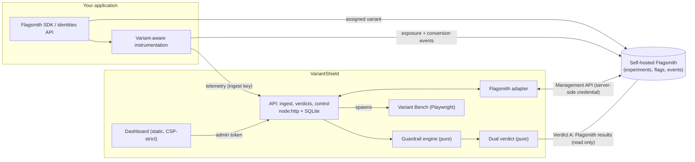
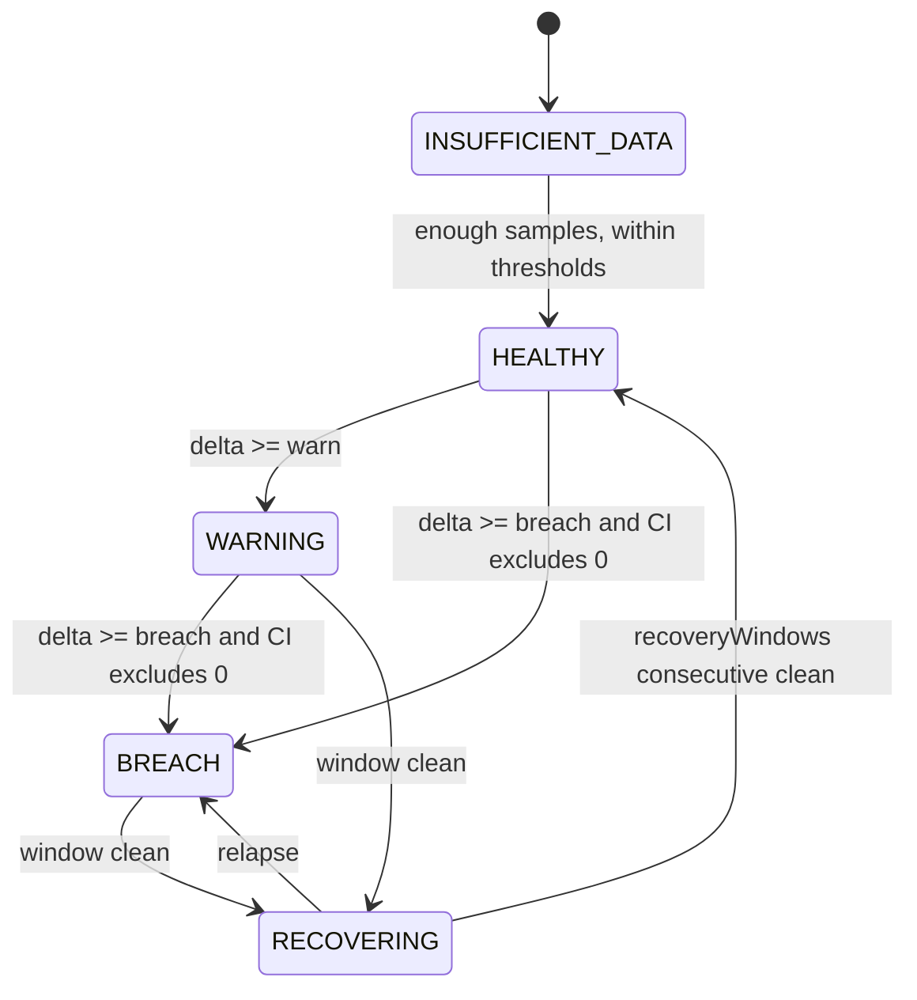
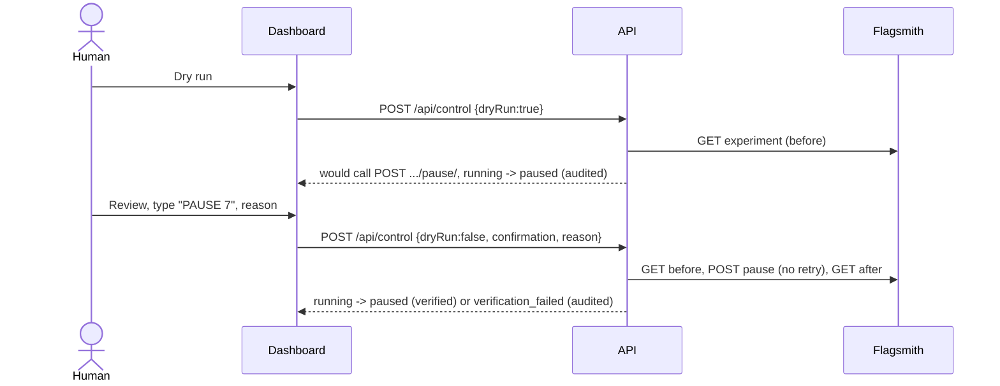

# Architecture



## Modules (`variantshield/`)

| Path | Responsibility | Depends on |
|---|---|---|
| `packages/flagsmith-adapter` | Typed Flagsmith client: experiments, results, exposures, identities, events, lifecycle. Retry (reads only), timeouts, typed errors, response validation. | Node `fetch` |
| `packages/telemetry` | Event schema + validation, PII rejection, idempotent ingest, token-bucket limiter, OTel attribute mapping. | none |
| `packages/guardrail-engine` | Pure, deterministic evaluation of four guardrails per variant against a baseline; recovery logic; seeded fixtures for simulation. | none |
| `packages/verdict` | Combines Flagsmith's result with the guardrail report into one of five outcomes with evidence. | engine |
| `apps/api` | HTTP API, SQLite persistence and migrations, auth, rate limits, board derivation, control flow, audit, bench runner, simulation. | all packages |
| `apps/dashboard` | Six screens, vanilla JS, no build. | API only |
| `apps/checkout-demo` | Three checkout variants, instrumentation, fault injection. | adapter |
| `apps/variant-bench` | Nine-test Playwright acceptance suite run per variant. | demo |

Dependency direction is one way: packages never import apps; the dashboard only talks HTTP.

## Guardrail statuses

`INSUFFICIENT_DATA` · `HEALTHY` · `WARNING` · `BREACH` · `RECOVERING`. Severity: BREACH > WARNING > RECOVERING > INSUFFICIENT_DATA > HEALTHY. A variant is `HEALTHY` only if every metric has sufficient samples. Rate metrics are compared to the baseline variant by absolute difference; `BREACH` additionally needs the Newcombe/Wilson lower bound of the difference to exceed zero (otherwise `WARNING`). Latency compares nearest-rank p95 as a ratio. `RECOVERING` means the current window is clean but fewer than `recoveryWindows` consecutive clean windows have passed since a breach or warning.



## Dual verdict outcomes

`WINNER_AND_SAFE`, `WINNER_BUT_UNSAFE`, `HEALTHY_BUT_INCONCLUSIVE`, `INSUFFICIENT_EVIDENCE`, `REQUIRES_INVESTIGATION`. A conversion winner is never promoted by itself; a breach on a running experiment recommends `pause`, and every control action still needs a human.

## Board state (derived, never edited)

`PLANNED` (no Flagsmith link) → `CONFIGURED` / `QUALIFYING` (Flagsmith `created`; qualifying while a bench run is running or has failures) → `RUNNING` / `WARNING` / `BREACH` (Flagsmith `running` + guardrail result) → `PAUSED` → `COMPLETED`. If Flagsmith is unreachable the card shows the last known status marked **stale**; VariantShield never claims "running" without a fresh Flagsmith answer.

## Control flow



## Data model (SQLite, versioned migrations)

`plans`, `events` (idempotency key = `event_id`, payload hash for conflict detection, `source` real|simulation, `attribution` valid|missing|unknown_variant), `bench_runs`/`bench_results`, `evidence`, `audit`, `schema_migrations`. Events are purged after `RETENTION_DAYS`.

## Cross-surface contracts (Phase 2)

```
 identity issuer (trusted backend) --> subjectRef + vsid1 token
        |
 surfaces: web | mobile | payment-api | risk-engine
   each: verify token -> ask Flagsmith for the variant of subjectRef -> resolve own features -> report observation
        |
 POST /api/contract-observations  (ingest key, token verified, deduped)
        |
 contracts store (immutable versions) + observations
        |
 evaluateContract (pure) --> findings, status      configDrift / observationDrift / silentSurfaces --> drift history
        |
 dashboard #/contracts, CLI `variantshield contract ...`, POST /api/contracts/:id/check (re-verifies with Flagsmith)
```

Package `packages/contracts` is pure (no I/O): manifest parsing, combination validation, identity primitives, correlation, drift. `apps/api/src/contracts.ts` adds persistence and the Flagsmith re-verification.

Tables added by migration 2: `contracts` (id, version, normalized JSON, immutable), `contract_observations` (identity_status verified|unlinked), `contract_findings` (dedupe key, kept as history), `contract_drift`, `assignment_config_snapshots`. The simulation contract id is `sim-checkout-journey`; real surfaces cannot write to it. Details: [`docs/guides/CONTRACTS.md`](../guides/CONTRACTS.md).
