# Incident Bisect: find the flag change that broke production

Built during Toggle Wars (started after the 26 November 2026 08:00 IST opening). Independent community project, not an official Flagsmith product.

## The problem

A regression starts minutes after several flag changes went out. Teams roll everything back (losing the good changes) or guess. When every change already reaches 100% of users there is no control group to compare against, so tools that compare a flag's own variants cannot help.

## What it does

VariantShield builds a control group on demand. A small canary cohort (a Flagsmith `PERCENTAGE_SPLIT` segment) gets a **subset of the recent changes reverted** through segment overrides; everyone else keeps today's flags. If the canary heals, the culprit is in that subset. A Bayesian planner picks each next subset, and an always-valid sequential test decides each probe. Pairs of changes that only fail together are handled, and so is "none of these changes". Before anyone acts, a confirmation probe reverts exactly the suspected culprit.

## Where it stops for a person

| Gate | What the person approves | Enforced by |
|---|---|---|
| 1. Envelope | Which changes may be reverted, canary size (1 to 20%), maximum rounds and minutes. Nothing touches Flagsmith before this. Typed confirmation `BISECT <id>` and a reason. | API; Guardian vetoes any probe outside it |
| 2. Remediation | Restoring the culprit for everyone. One person proposes, a **different** person approves with `REMEDIATE <id>`; the value is then read back from Flagsmith. | API (`self_approval_forbidden`), ledger |

Agents (including the MCP tools) can read incidents but cannot pass either gate. Every step is in the decision ledger (hash-chained, signed).

## The swarm

Seven deterministic agents share one blackboard (`incidents`, `probes`, `swarm_messages`). No model is involved.

| Agent | Job |
|---|---|
| Sentinel | Bernoulli CUSUM on the failure rate per minute; dates the onset and waits for two complete minutes. Later confirms recovery. |
| Archivist | Collects flag changes around the onset (watcher, signed webhook, audit log). |
| Profiler | Prior odds per change from recency to the onset and blast radius; pairs and "none" get their own mass. |
| Guardian | Proposes the envelope, vetoes probes outside it, aborts if the canary gets worse, removes the canary at the end. |
| Prober | Chooses the subset with the highest expected information gain and applies it as segment overrides. |
| Judge | Decides each probe with a two-sample mSPRT; checks the canary's traffic share (sample-ratio mismatch). |
| Scribe | Writes the ledger and drafts the remediation. |

```mermaid
stateDiagram-v2
  [*] --> INVESTIGATING: Sentinel alarm
  INVESTIGATING --> NOT_A_FLAG_CHANGE: no changes found
  INVESTIGATING --> AWAITING_APPROVAL: suspects and priors ready
  AWAITING_APPROVAL --> PROBING: person approves envelope
  PROBING --> CONFIRMING: one explanation >= 95%
  CONFIRMING --> IDENTIFIED: reverting exactly the culprit heals the canary
  CONFIRMING --> PROBING: it does not
  PROBING --> NOT_A_FLAG_CHANGE: "none" >= 95%
  PROBING --> INCONCLUSIVE: envelope exhausted
  PROBING --> ABORTED: canary harmed, error, or a person stops it
  IDENTIFIED --> REMEDIATION_PROPOSED: person A proposes
  REMEDIATION_PROPOSED --> REMEDIATED: person B approves; read back verified
  REMEDIATED --> RESOLVED: failure rate back near baseline
```



## Statistics (packages/bisect)

* **Onset:** Bernoulli CUSUM (Page 1954) with p0 from the first five minutes and p1 = max(2·p0, p0 + 2 pp), threshold 8.
* **Hypotheses:** none, each change, each pair. A probe reverting set R heals under Hi iff i ∈ R, under Hij iff i ∈ R or j ∈ R, never under "none".
* **Update:** Bayes' rule with a noisy channel (error 5%), as in noisy bisection (Horstein; Waeber, Frazier and Henderson 2013) and Google's flake-aware culprit finding (ICST 2023), which work over commits. Next R maximises mutual information; ties go to the smaller set.
* **Per probe:** plug-in two-sample mSPRT (Johari, Pekelis and Walsh, arXiv:1512.04922) with τ = Δ (the regression size): healed when the evidence ratio ≥ 20 and the gap is positive; not healed when the gap's always-valid upper bound is below half of Δ; harmful when the canary is worse by 2 pp. Validity is asymptotic (plug-in variance).
* **Cohorts** come from the flags each request reports, never from a hash VariantShield computes, so identity overrides or stale SDK caches simply drop out of both arms. Traffic in the first 30 s after a segment change is ignored.

Measured on seeded synthetic incidents (`node scripts/bisect-bench.ts --seeds 200`, 10% canary, 3,000 requests per probe batch, 1% → 8% failures):

| Case | Correct | Mean probes (worst) | Reverting one change at a time, in recency order |
|---|---|---|---|
| Single culprit, 8 changes | 100% | 4.55 (10) | 4.50 |
| Single culprit, 12 changes | 100% | 5.25 (13) | 6.46 |
| Pair that only breaks together, 8 changes | 100% | 9.81 (14) | names only one half |
| Not a flag change, 8 changes | 99.5% | 4.51 (8) | 8 |

With few changes the gain over a well-ordered one-at-a-time search is small; the planner earns its keep on interactions, on "it was not a flag", and as the number of changes grows. The worst cases exceed the default 12-round envelope and would end INCONCLUSIVE.

## Flagsmith integration (verified against Flagsmith's source and a real instance)

| Need | How | Notes |
|---|---|---|
| Recent changes | **Flag watcher**: `GET /api/v1/flags/` (environment key) every 5 s, diffed | Works on every plan and network. Timing is accurate to the poll interval. |
| | Signed webhook `POST /api/flagsmith/webhook` (`FLAG_UPDATED`, `X-Flagsmith-Signature` HMAC-SHA256) | Real time, but Flagsmith refuses webhook URLs on private networks ("URLs must not target internal or private network addresses"). |
| | Audit log `GET /api/v1/projects/{p}/audit/` and `/{id}/` change details | A self-hosted open-source organisation defaults to `audit_log_visibility_days = 0` (`organisations/models.py`), so the list is empty there. |
| Canary | `POST /api/v1/projects/{p}/segments/` with `PERCENTAGE_SPLIT` on `$.identity.key` | The serializer refuses a blank property. On a real Flagsmith a 10% split matched 35 of 400 identities. |
| Probe | `PATCH /api/__future__/environments/{key}/features/{id}/` `segment_overrides` | PATCH, never PUT (PUT deletes overrides it does not list). |
| Clear probe | `DELETE /api/__future__/.../segment-overrides/{segment}/`; segment deleted at the end | |
| Remediation | `PATCH .../features/{id}/` `environment_default`, then `GET` to verify | |

Identity overrides beat segment overrides; such identities report their own flags and are excluded from both cohorts. With change requests enabled Flagsmith answers 409 and the swarm aborts.

## Run it

```bash
npm run serve                                   # dashboard → Incident Room
```

In the Incident Room use **Simulate: …** (SIMULATION, in process, never touches Flagsmith). Against a real Flagsmith:

```bash
export FLAGSMITH_URL=... FLAGSMITH_ENVIRONMENT_KEY=... FLAGSMITH_ADMIN_TOKEN=...   # or FLAGSMITH_ADMIN_API_KEY
export VARIANTSHIELD_URL=http://127.0.0.1:8787 VARIANTSHIELD_INGEST_KEY=... VARIANTSHIELD_ADMIN_TOKEN=...
node scripts/storefront.ts --culprit new_tax_engine --rps 60          # approve the two gates in the dashboard
node scripts/storefront.ts --culprit fast_checkout+new_tax_engine --auto  # or let the script act as alice and bob
```

Your own apps report outcomes with the flags they were served:

```http
POST /api/bisect/signals
X-Ingest-Key: ...
{"signals":[{"identity":"user-42","ok":false,"flags":{"new_tax_engine":{"enabled":true,"value":null}}}]}
```

## Limits

* Proportions only (success or failure); latency needs a different test. Sample sizes grow as 1/Δ², so small regressions on low traffic take long.
* Interactions of three or more changes are not modelled; they show up as inconclusive.
* Associations within a randomised canary, not proofs; each probe has a nominal 5% error rate and errors compound over probes, which is why the confirmation probe exists.
* Single process, SQLite. The watcher's history starts when VariantShield starts.
